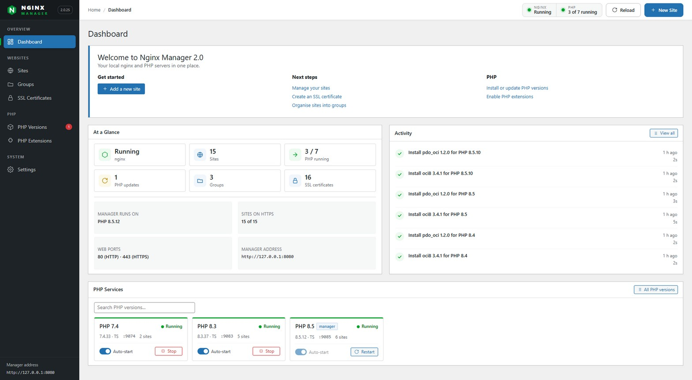
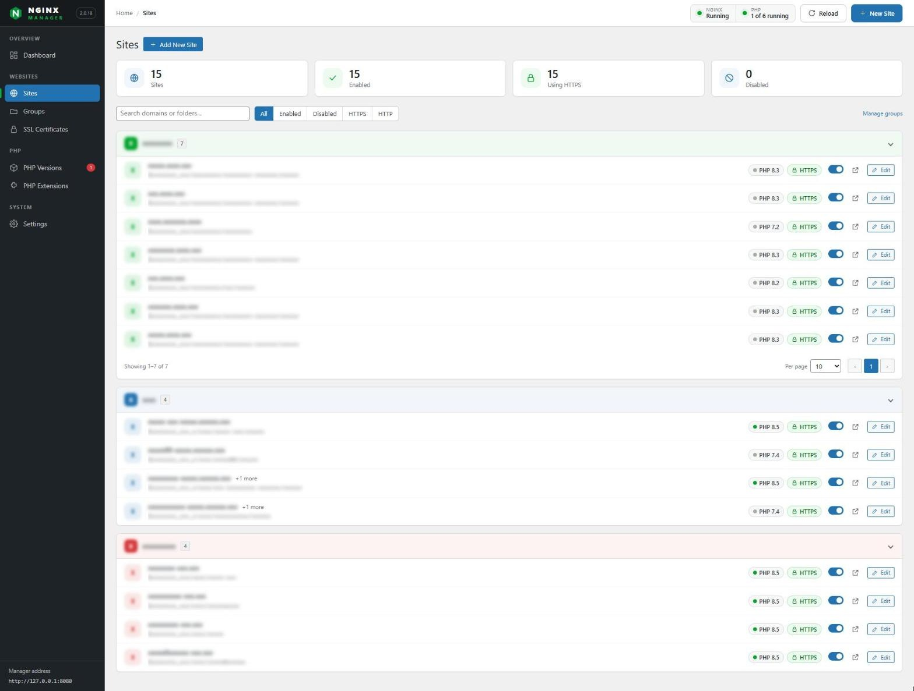
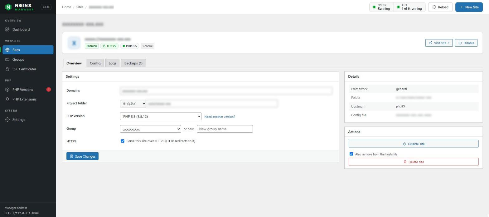
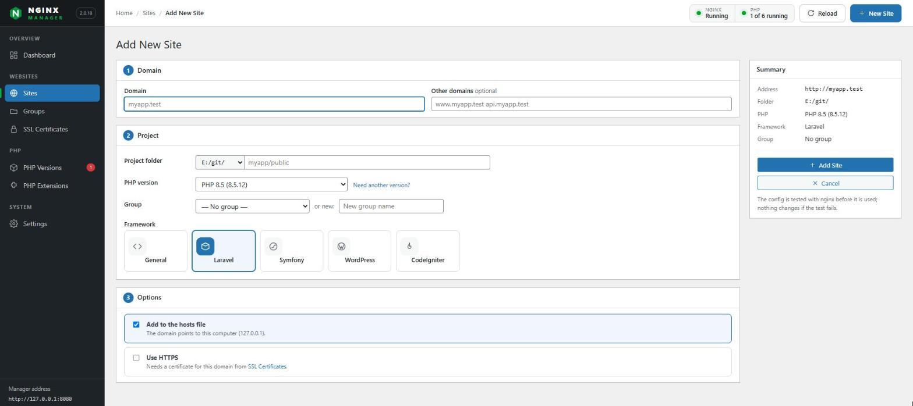
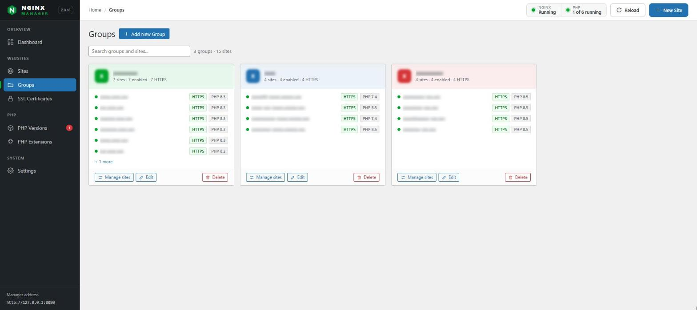
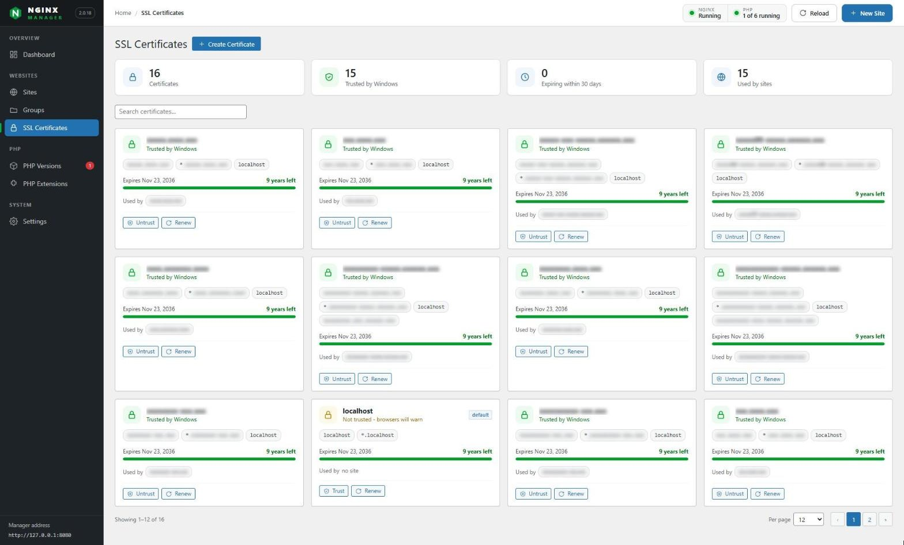
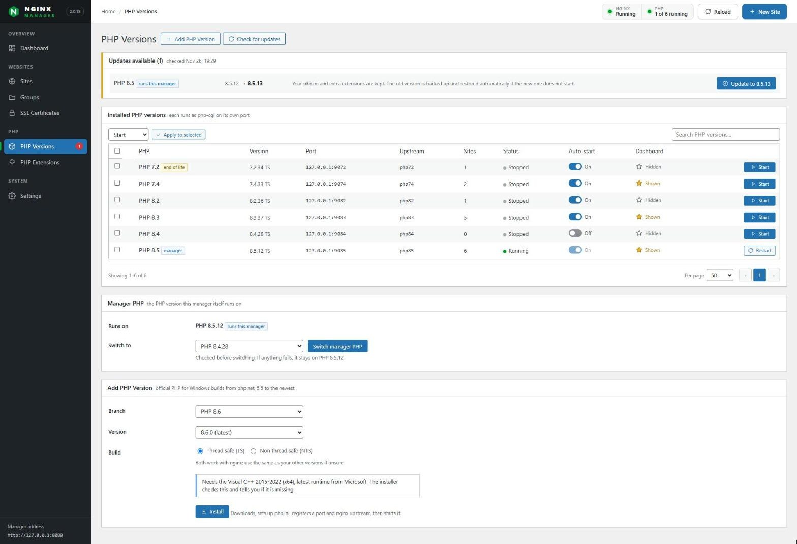
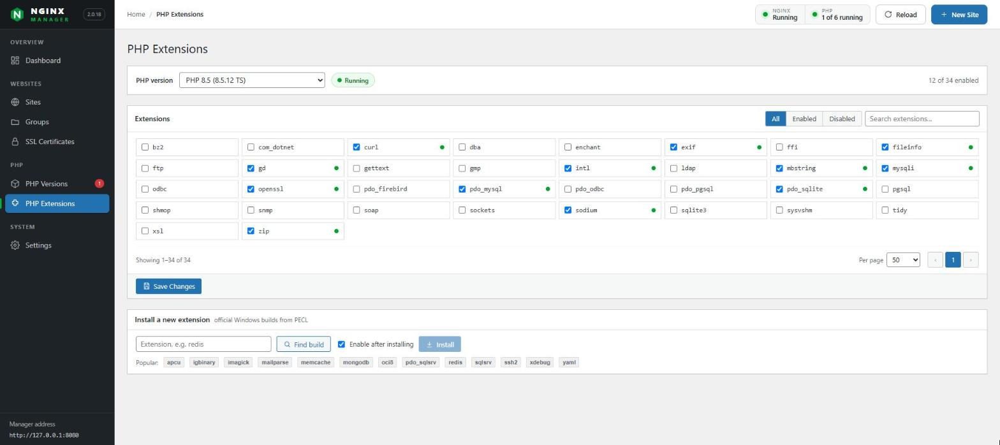
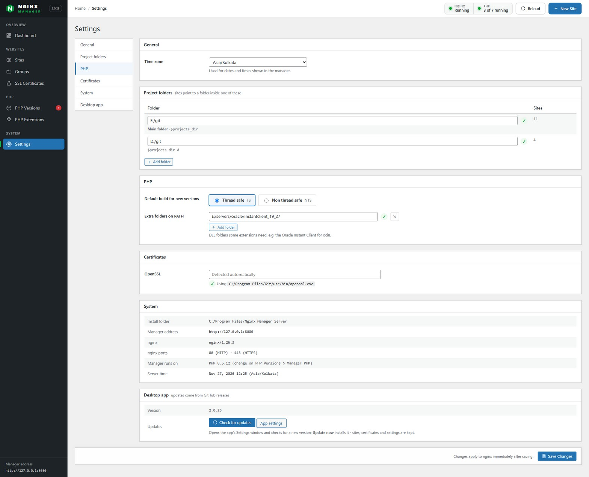

<!--
/******************************************************************************
 *
 *  Project : nginx-manager-2.0
 *  File    : README.md
 *  Date    : 26/11/2026
 *  Author  : Semansys Development Team
 *
 *  Copyright (c) 2026
 *  Tel: +91 97863 37914
 *  Email: dev.digiboost.muthu@gmail.com
 *  All rights reserved, see the LICENSE file for more information.
 *
 ******************************************************************************/
-->

# Nginx Manager 2.0 - local nginx + multi-PHP development server for Windows and macOS


**Nginx Manager** is a portable **local development environment** for PHP: **nginx** plus
**multiple PHP versions running side by side** (5.5 up to the newest), managed from a clean
**browser-based control panel** or a **desktop app**. Give every project its own local domain
(virtual host), its own PHP version and a trusted **local HTTPS (SSL) certificate** - without
hand-editing nginx or php.ini files. Works with Laravel, Symfony, CodeIgniter and plain PHP.

**Download:** [Windows installer and macOS app - latest release](https://github.com/muthu-digiboost/nginx-manager-2.0/releases/latest)
(the Windows installer includes nginx and PHP 8.5 and updates itself from the app).

### Why Nginx Manager?

- **Several PHP versions at once** - each project keeps the PHP it needs (e.g. 7.4, 8.3 and 8.5
  in parallel), switch a site's PHP version with one click.
- **Local HTTPS that browsers trust** - self-signed certificates created and trusted for you;
  HTTP redirects to HTTPS automatically.
- **Safe nginx changes** - every config change is tested with `nginx -t` and rolled back if nginx
  rejects it, so one mistake never takes the other sites down.
- **Virtual hosts in seconds** - domain, project folder, PHP version, hosts file entry and
  certificate in one form.
- **PHP extensions without php.ini editing** - a checkbox per extension, plus one-click PECL
  installs (redis, xdebug, apcu, imagick, oci8, ...).
- An alternative to all-in-one stacks such as XAMPP, WAMP, Laragon or MAMP for developers who
  want **nginx**, **several PHP versions at once** and **local HTTPS** with no manual config.

| | |
|---|---|
| **Manager UI** | `http://127.0.0.1:8080` (local only) |
| **Runs on** | Windows 10/11 (Windows PowerShell 5.1, built in) · macOS (Homebrew) |
| **Needs on Windows** | `nginx.exe` and at least one PHP build in `php\` · Git for Windows (for `openssl.exe`) |
| **Needs on macOS** | [Homebrew](https://brew.sh), `nginx` and one PHP 8.1+ from Homebrew (see [macOS](#macos)) |

---

## Contents

1. [Features](#features)
2. [Screenshots](#screenshots)
3. [Quick start](#quick-start) (Windows)
4. [macOS](#macos)
5. [Desktop app](#desktop-app)
6. [Using the manager](#using-the-manager)
7. [How it works](#how-it-works)
8. [Folder layout](#folder-layout)
9. [Scripts](#scripts)
10. [Security](#security)
11. [Backups and recovery](#backups-and-recovery)
12. [Moving to another machine](#moving-to-another-machine)
13. [Troubleshooting](#troubleshooting)
14. [Development](#development)

---

## Features

- **Dashboard** - server status, sites / PHP / certificate counts, PHP updates waiting,
  recent activity, and quick start/stop tiles for the PHP versions you star.
- **Sites** - grouped list with search and filters; add a site (domain, project folder,
  PHP version, framework, group, HTTPS); edit everything later; raw config editor;
  logs; automatic backups with one-click restore; enable / disable / delete.
  Every change is checked with `nginx -t` and **rolled back automatically** if nginx
  rejects it, so a mistake can never take the other sites down.
- **Groups** - organise sites per client, product or team (name + colour).
- **SSL Certificates** - create self-signed certificates (domain, `*.domain`,
  `localhost` + extras), trust them on the computer (Windows trust store / macOS keychain)
  so browsers show no warning, renew
  (the old certificate stays in use until the new one exists; extra domains are kept),
  switch a site to HTTPS in the same step.
- **PHP Versions** - install **any** PHP: official Windows builds from 5.5 to the newest
  (macOS: Homebrew, 5.6 to the newest), one-click updates (Windows: checksum
  verification and automatic rollback),
  start / stop / restart one or several versions, "Auto-start" per version, and choose
  which PHP the manager itself runs on (checked first, switched back automatically on failure).
- **PHP Extensions** - cPanel-style checkbox grid per PHP version; switch extensions
  on/off safely (php.ini is tested and restored if PHP cannot load one); install new
  extensions (redis, xdebug, apcu, imagick, ...) in one click (Windows: PECL builds;
  macOS: Homebrew).
- **Settings** - project folders, extra PATH folders for PHP, OpenSSL location,
  time zone - all from the browser.
- **Background jobs** - long tasks (installs, updates, restarts) run detached with a
  live log; the page reconnects even when the manager's own PHP restarts.
- **Desktop app** - optional Windows / macOS app with its own window and a tray icon; the
  servers keep running in the background (see [Desktop app](#desktop-app)).

## Screenshots

Domain names, project folders and group names are blurred.

**Dashboard** - server status, counts, recent activity and the PHP versions you star.



**Sites** - grouped list with search, filters, PHP version, HTTPS and on/off per site.



**Site details** - domains, project folder, PHP version, group and HTTPS; tabs for the raw
config (checked with `nginx -t`), logs and backups.



**Add a site** - domain, project folder, PHP version, framework, group, hosts file and HTTPS.



**Groups** - sites per client, product or team.



**SSL Certificates** - self-signed certificates, trusted by Windows, with renew / untrust.



**PHP Versions** - install any version, updates with rollback, start / stop, auto-start,
and the PHP the manager itself runs on.



**PHP Extensions** - checkbox grid per PHP version, plus PECL installs.



**Settings** - project folders, extra PATH folders for PHP, certificates, system details.



## Quick start

1. **Get the files** - clone or copy this folder anywhere (any drive, any path).
2. **Add the runtime** (not stored in git):
   - `nginx.exe` in the install folder,
   - at least one PHP build in `php\<version>\` (e.g. `php\8.3\`). The manager itself needs
     PHP 8.1 or newer. More versions can be installed later from the PHP Versions page.
3. **Allow local scripts** once (PowerShell, as your normal user):
   ```powershell
   Set-ExecutionPolicy -Scope CurrentUser RemoteSigned
   ```
4. **Start everything** - right-click `start-all.ps1` → *Run with PowerShell*
   (or run `.\start-all.ps1 -Open`). Windows asks for Administrator **once**.
5. Open **http://127.0.0.1:8080** and go to **Settings → Project folders** to set the
   folder that holds your projects. Then **Sites → Add New Site**.

On the first run the manager creates `.env` from `.env.example`, `data\settings.json`
from the PHP folders it finds, and a default `localhost` certificate - nothing to edit
by hand.

> **Start without the UAC prompt every time:** run `scripts\install-autostart.ps1` once.
> It registers a Windows task that starts the servers as Administrator when you log on.
> `scripts\install-autostart.ps1 -Remove` undoes it.

## macOS

> **Status:** macOS support is new. Its code is covered by automated tests (run on Windows
> with simulated macOS commands), but it has **not yet been run on a real Mac**. Please
> report anything that does not work.

The pages and features are the same as on Windows. What differs is where things come from:

| | Windows | macOS |
|---|---|---|
| nginx | `nginx.exe` in the install folder | `brew install nginx` |
| PHP versions | php.net builds in `php\<version>\` | Homebrew `shivammathur/php` tap (5.6 - 8.5) |
| Extensions | PECL DLLs, `php.ini` | Homebrew `shivammathur/extensions` tap, `php.ini` + `conf.d/*.ini` |
| Certificate trust | Windows trust store (`certutil`) | your login keychain (`security`; macOS asks for your password) |
| Hosts file | edited directly (runs as Administrator) | `/etc/hosts` - macOS asks for an administrator password |
| Scripts | `*.ps1` | `*.sh` (same names) |
| Start at login | `scripts\install-autostart.ps1` | `scripts/install-autostart.sh` |

Everything runs as your normal user - no `sudo`.

**Quick start on macOS**

1. Install [Homebrew](https://brew.sh), then nginx and one PHP for the manager:
   ```bash
   brew install nginx
   brew tap shivammathur/php
   brew install shivammathur/php/php@8.5
   ```
2. Clone or copy this folder anywhere, then start everything:
   ```bash
   ./start-all.sh --open
   ```
   The first run creates `.env`, `data/settings.json` from the PHP versions Homebrew has
   installed (the manager runs on the newest PHP 8.1+), and the `localhost` certificate.
3. In the manager: **Settings → Project folders** (e.g. `/Users/you/Sites`), then
   **Sites → Add New Site**. More PHP versions: **PHP Versions → Add PHP Version**.

Optional `.env` keys for macOS: `NGINX_BIN` (nginx binary) and `BREW_PREFIX` (Homebrew
folder); both are detected automatically (`/opt/homebrew` on Apple silicon, `/usr/local`
on Intel).

## Desktop app

Instead of opening `http://127.0.0.1:8080` in a browser you can use **Nginx Manager** as an
app (Windows and macOS, built with Electron in `desktop/`):

- **Click the app** - it starts the servers if they are not running (Windows asks for
  Administrator once, as `start-all.ps1` does) and shows the manager in its own window.
- **Close the window** - it hides to the tray (Windows) / menu bar (macOS); nginx and PHP
  keep running, so your sites keep working. Clicking the app again brings the window back.
- **Tray / menu-bar icon:** Open · status (running, PHP version) · Start all · Stop all ·
  Restart all · Reload nginx · Open in browser · Start at login · Change Nginx Manager
  folder · Quit (servers keep running) · Quit and stop servers.
- Only the manager opens inside the window; your sites and other links open in the default
  browser.
- No questions: the installed app finds its server folder by itself (see **New PC** below);
  another folder can be chosen later from the tray icon (Change Nginx Manager folder).
- No PowerShell windows: the app runs the scripts hidden (`-Hidden`); Windows only shows
  its Administrator prompt.

**Updates:** in the manager **Settings → Desktop app → Check for updates** (shown only inside
the app), or tray icon → **Settings...** (or **Check for updates...**) → **Check for updates** →
**Update now**. Windows downloads the new version (checked against its SHA-512), installs it and
restarts the app; macOS opens the download page of the new version (automatic installing
needs an Apple-signed app). The app also checks by itself a little after starting and every
6 hours, and tells you when a new version is out. Updates replace the app and refresh the
manager's code in the server folder - `.env`, sites, certificates, settings, logs and backups
are never touched, and PHP versions are yours after the first setup (an update neither
changes a php.ini nor brings back a version you removed). Unchanged files are skipped, so
an update works while nginx and PHP keep running. New versions come from this repository's
GitHub releases: every push to `main` publishes one (`v2.0.<build number>`). Only a
**higher** number counts as an update - after installing a locally built `2.0.<n>`, the
Update button stays quiet until GitHub's number is higher.

**New PC:** the installer brings everything (the manager, nginx 1.26.3 and PHP 8.5.12 on Windows; add
more PHP versions in the app under PHP Versions → Add). The servers start in the background,
without a PowerShell window (Windows only asks for Administrator).
Nothing is asked: on first start the app sets Nginx Manager up by itself and starts it.

| | App | Server folder (nginx, PHP, your sites, certificates, settings) |
|---|---|---|
| Windows | `C:\Program Files\Nginx Manager` | `C:\Program Files\Nginx Manager Server` |
| macOS | `/Applications/Nginx Manager.app` | `~/NginxManager` |

The server folder sits next to the app folder, not inside it, because every update replaces
the app folder completely. The installer (already Administrator) sets it up and refreshes the
code on every update; it keeps the normal Program Files protection - users can read it, only
Administrators can change it, so nobody can slip code into the scripts that run elevated.
nginx and PHP run as Administrator and write their logs, sites and certificates there. Only
if the installer's setup did not happen, the app sets up in
`%LOCALAPPDATA%\Nginx Manager Server` instead, without asking. A setup made by an
older version (`C:\NginxManager`) or a machine that already runs the manager is found and used;
nothing is copied. The folder can be changed later from the tray icon. PHP needs the Microsoft
Visual C++ 2015-2022 Redistributable (x64); the app checks this and links to Microsoft's
download if it is missing.

**Install:** run `Nginx Manager Setup <version>.exe` (Windows; it asks for Administrator once,
to install into Program Files) or open the `.dmg` (macOS). The builds are not code-signed:
Windows shows "Windows protected your PC" (More info → Run anyway), macOS asks you to
right-click → Open the first time.

**Uninstall** (Windows, Settings → Apps): removes the app, its settings and Start at login.
An unticked checkbox also deletes the server folder (nginx and PHP are stopped first, the
"NginxManager2" logon task is removed; links inside the folder are removed, never followed).
Left unticked, the folder and its record stay, and a reinstall uses it again.

**Build it yourself** (Node.js 22.12 or newer):
```bash
cd desktop
npm ci
npm start            # run the app from the repo (uses the folder above desktop/)
npm test             # tests of the app's own logic
npm run dist:win     # -> desktop/dist/Nginx Manager Setup <version>.exe   (on Windows)
                     #    bundled PHP: 8.5.12 (pinned SHA-256); another exact version with
                     #    NM_BUNDLE_PHP=8.5.13 npm run dist:win (php.net's checksum is used)
npm run dist:mac     # -> desktop/dist/Nginx Manager-<version>-universal.dmg (on a Mac)
npm run icons        # re-create the icons from manager/public/assets/logo.svg
```

**Automatic builds** - the app is rebuilt whenever `main` changes, by a direct commit or by a
merge from another branch:

- **On your computer (git hooks):** after every commit or merge on `main` (including
  `git pull`), `.githooks/rebuild-desktop.sh` rebuilds the app in the background - git
  returns at once. Windows builds the installer, macOS the `.dmg`, into `desktop/dist/`;
  progress in `desktop/dist/auto-build.log`. Other branches never build. Turn the hooks on
  once per clone:
  ```bash
  git config core.hooksPath .githooks
  ```
  Options: `git config nm.buildBranch <branch>` (build another branch instead of `main`),
  `git config nm.autoBuild false` (off).
- **On GitHub (GitHub Actions):** every push to `main` - including a merged pull request -
  runs `.github/workflows/desktop.yml`:
  1. **Tests** on Windows: PHP (8.5), PowerShell (Pester) and the desktop app.
  2. **Draft release** `v2.0.<build number>`.
  3. **Windows:** builds the installer and **publishes the release at once** - installed
     apps see it under Check for updates within minutes.
  4. **macOS**, at the same time: runs the desktop tests on a Mac, builds the `.dmg` and
     **adds it to the same release** when it is done (GitHub's Mac machines are sometimes
     queued - the release never waits for them).

  The files are also on the run's page under **Artifacts** (kept 30 days). A run that fails
  publishes nothing; the next push simply gets the next number. Pushing the workflow file
  needs a GitHub login with the `workflow` permission.

## Using the manager

| Page | What you do there |
|---|---|
| **Dashboard** | See status at a glance; start/stop the PHP versions you starred (★ on PHP Versions). |
| **Sites** | Add, find, filter, enable/disable sites. Click a site for its details page. |
| **Site details** | *Overview*: domains, project folder, PHP, group, HTTPS. *Config*: raw nginx config (tested before saving). *Logs*: last error/access lines. *Backups*: restore any previous version. |
| **Groups** | Create groups, choose which sites belong to each. |
| **SSL Certificates** | Create / renew / trust / delete certificates; switch a site to HTTPS. |
| **PHP Versions** | Updates, installed versions (start/stop/restart, Auto-start, ★ Dashboard), Manager PHP, Add PHP Version. |
| **PHP Extensions** | Pick a PHP version, tick extensions, Save; install new ones from PECL. |
| **Settings** | Project folders, PHP PATH folders, default PHP build (TS/NTS), OpenSSL, time zone. |

**Auto-start** - only versions switched on (plus the PHP the manager itself runs on) start
with the server. Others stay stopped until you click *Start*, so only what you need uses memory.

**Manager PHP** - the manager itself can run on any installed PHP 8.1 or newer
(PHP Versions → *Manager PHP* → *Switch manager PHP*). Before switching, the manager's
code is checked with that version (syntax, tests, deprecation warnings) and the extensions
it needs (mbstring, openssl) are enabled if missing. If anything fails, or the manager does
not answer afterwards, it switches back automatically. The previous version keeps running.

**Old PHP versions (e.g. 5.6)** need the matching Microsoft Visual C++ runtime
(5.6 → Visual C++ 2012 x64). The installer tests the new build and tells you which
runtime is missing instead of failing silently.

## How it works

```
 Browser ──► nginx (80/443) ──► conf/sites/<site>.conf ──► fastcgi_pass phpXX
                │                                               │
                │ 127.0.0.1:8080                                ▼
                └──► manager UI (PHP)            php\<ver>\php-cgi.exe  127.0.0.1:90XX
```

- **One source of truth.** `data\settings.json` lists the installed PHP versions (port,
  upstream, version, build, auto-start). `.env` holds machine values (project folders,
  ports, time zone). The PowerShell scripts and the web UI both read them.
- **Generated nginx files** (never edit them): `conf\generated\upstreams.conf`
  (one `upstream phpXX` per PHP version), `conf\generated\env.conf` (the project folder
  variables), `conf\manager\manager.conf` (the manager itself). They are rewritten on
  start and after every relevant change.
- **No absolute paths in configs.** nginx always runs with `-p <install folder>/`, so
  configs use relative paths (`../ssl/<domain>/...`, `logs/...`). Project roots are
  written as `$projects_dir/app/public` (or `$projects_dir_d/...` for an extra folder);
  the variable is filled from Settings. Move the install folder or a project drive and
  only Settings changes.
- **Ports.** PHP `8.4` listens on `127.0.0.1:9084` (9000 + major.minor). When a port is
  taken the next free port from 9100 is used.
- **Safe writes.**
  - Site config: backup → write → `nginx -t` → restore on failure. The site form only
    rewrites the fields you changed, so hand-edited parts of a config are kept. Changing
    domains or turning HTTPS off only touches the site's own HTTP → HTTPS redirect (the
    block with the same domains); hand-written redirects such as `www → bare domain` stay.
  - php.ini: backup → write → `php -v` check → restore on load errors.
  - PHP update: refused while another program has the PHP folder open; the old folder is
    kept and put back, and PHP started again, if anything goes wrong.
  - Certificate renewal: the new key and certificate are created next to the old ones and
    swapped in together only when OpenSSL succeeded (both are put back if the swap fails);
    the old certificate leaves the Windows trust store only after that. nginx reloads when
    a site uses it.
  - `data\*.json`: the web UI and the scripts share one lock and replace files in one step,
    so changes made at the same time are never lost.
- **Jobs.** Installs, updates, restarts and the manager PHP switch run as detached
  PowerShell scripts (`data\jobs\<id>.json` + `.log`); the job page polls the log and
  reconnects when the manager's own PHP restarts. A job that cannot start is marked
  *failed* with the reason; one still *queued* after a minute is shown as "did not start".
- **Manager PHP.** `data\settings.json` names the PHP the manager runs on
  (`managerVersion`). `/health` reports which PHP answers; the switch job uses it to
  confirm the manager came back.

## Folder layout

```
nginx-manager-2.0/
├── start-all.ps1  stop-all.ps1  restart-all.ps1  reload-nginx.ps1     Windows
├── start-all.sh   stop-all.sh   restart-all.sh   reload-nginx.sh      macOS
├── .env.example            template for machine settings (.env is created from it)
├── .github/workflows/      desktop.yml: tests + desktop app builds on every push to main
├── .githooks/              post-commit / post-merge: rebuild the desktop app on main locally
├── desktop/                the desktop app (Electron): main.js, lib/, assets/, tests,
│                           build/installer.nsh (Windows installer), scripts/bundle.js
├── conf/
│   ├── nginx.conf          main config (committed)
│   ├── generated/          upstreams + project folder variables   (generated)
│   ├── manager/            manager vhost                          (generated)
│   └── sites/              one .conf per site (+ .conf.disabled)  (your data)
├── manager/                the web UI (PHP, no framework, no Composer)
│   ├── public/             index.php + assets (CSS, JS, logo)
│   ├── src/                classes: Http, Support, Nginx, Php, Ssl, Groups, Hosts, Controllers,
│   │                       Mac (the macOS jobs and services)
│   ├── views/              page templates
│   └── bin/manager.php     CLI used by the scripts (config:write, ext:enable; macOS: server:*, job:run)
├── scripts/                php-service, install-php, install-extension, switch-manager-php,
│                           install-autostart (.ps1 / .sh), lib/Common.psm1, lib/common.sh
├── ssl/                    certificates per domain + configuration.conf (OpenSSL template)
├── php/                    Windows: PHP builds, one folder per version (not in git)
├── data/                   settings.json, groups.json, jobs, caches    (not in git)
├── backups/                site configs, php.ini, old PHP folders      (not in git)
├── logs/  temp/                                                        (not in git)
└── tests/                  PHP tests (tests\run.php; macOS tests in tests\Mac) + Pester tests (tests\ps)
```

**Git holds code and templates only.** Sites, certificates, settings, PHP builds, logs and
backups are ignored, so the same repository works on any machine.

## Scripts

**Windows:** PowerShell scripts; they ask for Administrator when they need it and accept `-NoPause`.
`start-all`, `stop-all`, `restart-all` and `reload-nginx` also accept `-Hidden`: the
Administrator copy then runs without a window (the desktop app uses it; by hand the window
shows the progress).

| Script | Purpose |
|---|---|
| `start-all.ps1 [-Open]` | Prepare settings/certificate, regenerate nginx files, start auto-start PHP versions and nginx. |
| `stop-all.ps1` | Stop nginx and every php-cgi **of this install** (other installs are left alone). |
| `restart-all.ps1` | Stop, then start. |
| `reload-nginx.ps1` | Test the config and reload nginx only if the test passes. |
| `scripts\php-service.ps1 -Action start\|stop\|restart -Id 8.3[,8.4]` | Control one or more PHP versions. |
| `scripts\install-php.ps1` | Install / update a PHP version (normally started from the UI). |
| `scripts\install-extension.ps1` | Install a PECL extension (normally started from the UI). |
| `scripts\switch-manager-php.ps1 -Id 8.4` | Run the manager on another PHP version (normally started from the UI). |
| `scripts\install-autostart.ps1 [-Remove]` | Start the servers at logon, elevated, without a prompt. |
| `scripts\remove-install.ps1 -Base <folder>` | Used by the desktop app's uninstaller: stops what runs from a server folder the app set up and deletes it (never another folder). |

**macOS:** bash scripts with the same names; they run as your user (no `sudo`).

| Script | Purpose |
|---|---|
| `./start-all.sh [--open]` | Same as `start-all.ps1` (first run: settings from Homebrew's PHP versions). |
| `./stop-all.sh` · `./restart-all.sh` · `./reload-nginx.sh` | Same as the Windows scripts. |
| `scripts/install-autostart.sh [--remove]` | Start the servers when you log in (a LaunchAgent). |

On macOS, installs, updates, restarts and the manager PHP switch run as
`manager/bin/manager.php job:run ...` - started by the UI, nothing to run by hand.

## Security

- On Windows the manager runs as **Administrator** (it edits the hosts file, the Windows
  trust store and php\); on macOS it runs as your user and macOS asks for a password when
  the hosts file or keychain changes. Either way it listens on **127.0.0.1 only** and
  cannot be reached from the network.
- Every form is protected against cross-site requests (per-session token + Origin check);
  requests with a foreign `Host` header are refused (DNS-rebinding protection); other
  websites cannot frame or read manager pages.
- External programs are started without a shell and with validated arguments; background
  jobs can only run the scripts in `scripts\`.
- Downloads: PHP builds of supported branches are verified with php.net's SHA-256.
  Archived PHP builds and PECL extensions have no published checksum and are downloaded
  over HTTPS only (the UI says so).
- Desktop app (Windows):
  - The installer contains only files tracked by git plus nginx and PHP with **pinned
    SHA-256** checksums - never your `.env`, sites, certificates, logs or project folders
    (the build fails if any slips in).
  - The server folder in Program Files keeps the normal protection: only Administrators can
    change it, so no program running as a normal user can change the scripts that run
    elevated. The installer sets it up and updates it.
  - The uninstaller runs its delete script from the app's own folder, deletes only a folder
    the app set up (marker `data\.nm-app-version`) and never follows links out of it.

## Backups and recovery

| What | Where |
|---|---|
| Every site config before a change | `backups\sites\<site>\<date-time>.conf` (restore from the site's *Backups* tab) |
| Deleted sites | `backups\deleted\` |
| php.ini before extension changes | `backups\php-ini\<version>\` |
| PHP folder before an update | `backups\php\<version>-<old version>-<date-time>\` |
| Replaced extension DLLs | `backups\ext\<version>\` |

## Moving to another machine

Copy (or clone) the folder, add `nginx.exe` and the PHP builds (macOS: `brew install` them),
run `start-all.ps1` (macOS: `./start-all.sh`), then set the project folders on **Settings**.
Settings and sites can move between Windows and macOS, but project folders and PHP
versions must be set again for the new machine. To take your sites along, also copy `conf\sites\`,
`ssl\` and `data\`.

## Troubleshooting

| Symptom | Fix |
|---|---|
| A PHP version shows *foreign* / will not start | Another program uses its port - usually an old server still running. Stop it and start again. |
| "This PHP build does not run on this machine" | Install the Microsoft Visual C++ runtime named in the message. |
| Hosts file or certificate trust fails | The server is not running as Administrator - start it with `start-all.ps1` (it asks once). |
| Browser still warns about a certificate | Trust it on SSL Certificates, then restart the browser. |
| Site shows 403 | The project folder has no index file, or the folder in the site's Overview is wrong. |
| Site shows 502 | Its PHP version is stopped - start it on PHP Versions (and turn on Auto-start). |
| nginx rejected a change | Nothing was applied; the message shows nginx's error. Fix it in the Config tab. |
| Scripts are blocked | `Set-ExecutionPolicy -Scope CurrentUser RemoteSigned` |
| Manager page does not load (502) | Its PHP is not running - run `start-all.ps1`. |
| "PHP x cannot run the manager cleanly yet" | The job log lists the problems (PHP deprecations, warnings, errors or failed tests); the manager stays on its current PHP. Pick another version or fix them first. |
| A job says "did not start" | PowerShell could not run the script. Run the same script from a PowerShell console (see [Scripts](#scripts)) to see the error. |
| "php\x is in use by another program" (PHP update) | Close the IDE, terminal or tool using that `php.exe` and update again. PHP was started again. |
| A project folder is refused on Settings | Folder names containing `$ " ' ; # { }` would break nginx - rename the folder. |
| Installer: "Nginx Manager cannot be closed", or "Windows cannot access the specified device" | An antivirus (e.g. Avast CyberCapture) is checking the new, unsigned program. Wait until it is done, then Retry - or add `C:\Program Files\Nginx Manager\` and `C:\Program Files\Nginx Manager Server\` as exceptions. |
| Update button shows no new version | Only a higher version number counts. After installing a locally built version, wait for the next GitHub release, or install it from the Releases page. |
| Desktop app: servers do not start | Click **Yes** on Windows' Administrator prompt (tray → Start all asks again). Details: `%APPDATA%\Nginx Manager\logs\main.log`. |
| macOS: `start-all.sh` says Homebrew, nginx or PHP is missing | Run the `brew` commands it prints, then start again. |
| macOS: `Permission denied` when starting a script | `chmod +x *.sh scripts/*.sh` (the folder was copied without file permissions). |
| macOS: nginx does not start on port 80/443 | Another web server uses the port (e.g. `brew services` nginx or Apache): `brew services stop nginx`, `sudo apachectl stop`. |

## Development

```powershell
php\8.5\php.exe tests\run.php                                        # PHP tests (any PHP 8.1+)
powershell -NoProfile -ExecutionPolicy Bypass -File tests\ps\run.ps1  # Pester tests
cd desktop; npm test                                                 # desktop app tests (Node.js 22.12+)
```

- No Composer and no framework: plain PHP 8.1+ (mbstring, openssl), PSR-4 autoloader in
  `manager\src\autoload.php`. Raising the minimum means updating
  `manager\src\Support\ManagerRequirements.php` and `scripts\switch-manager-php.ps1`.
- Every source file starts with the project header (Project / File / Date / Author /
  Copyright) followed by a short description of its purpose.
- PowerShell files are ASCII only (Windows PowerShell 5.1 reads BOM-less files as ANSI);
  everything the project writes is UTF-8 **without** BOM.
- Never put absolute paths in code, scripts or committed configs - use `Paths` (PHP),
  `Get-ManagerBase` (PowerShell) and the values from Settings.

---

© 2026 Semansys Development Team · see [LICENSE](LICENSE)
